# CargoSync Mobile App — Architecture Document

**Single Source of Truth:** Google Stitch Project *CargoSync Mobile App Redesign* (`projects/6541042153999791419`)  
**Technology Stack:** React Native 0.86.3, Expo SDK 57, React 19.2.3, React Navigation v7, TypeScript 6.0

---

## 1. Directory Structure

```
cargoSync/
├── App.tsx                      # Root component: Inter Font loader, ThemeProvider, LanguageProvider, AuthProvider
├── DEVELOPMENT_STATUS.md        # Live implementation tracker by phase and batch
├── ARCHITECTURE.md              # Technical architecture documentation
├── src/
│   ├── theme/
│   │   ├── tokens.ts            # Centralized design tokens (Stitch source of truth)
│   │   ├── ThemeProvider.tsx    # Theme context & hook (useTheme)
│   │   └── index.ts             # Theme re-exports
│   ├── context/
│   │   ├── LanguageContext.tsx  # Bilingual context (English & हिंदी) with full dictionary
│   │   └── AuthContext.tsx      # Multi-role authentication & company management context
│   ├── components/
│   │   ├── common/
│   │   │   ├── AppButton.tsx    # Reusable primary, secondary, destructive, ghost, outline buttons
│   │   │   ├── Headers.tsx      # AppHeader (stack back nav) & TabHeader (logo, avatar, pill)
│   │   │   ├── StatusBadge.tsx  # Semantic badges & uppercase telemetry badges
│   │   │   └── Cards.tsx        # Elevated cards, KPI cards, alert cards
│   │   ├── forms/
│   │   │   ├── FormInput.tsx    # Floating label/input with focus rings and error states
│   │   │   ├── RadioOptionCard.tsx # Radio cards with sub-options (Account/Role selection)
│   │   │   └── DocumentUploader.tsx# expo-document-picker & expo-image-picker uploads
│   │   └── feedback/
│   │       └── SystemStateView.tsx # Empty, loading, error, offline, success states
│   ├── navigation/
│   │   ├── RootNavigator.tsx    # Top-level switcher between Auth, Shipper, Driver, Fleet, Admin
│   │   ├── AuthNavigator.tsx    # Welcome -> AccountSelection -> Role/Company Onboarding
│   │   ├── CompanyAdminNavigator.tsx # Admin Tabs & Team Management
│   │   ├── ShipperNavigator.tsx # Shipper tab navigator + Stack (CreateShipment, FindTrucks, ShipmentDetails)
│   │   ├── DriverNavigator.tsx  # Driver tab navigator + Stack (JobDetailsAccept, ConfirmPickup, Navigation, CompleteDelivery, ReportProblem)
│   │   ├── FleetNavigator.tsx   # Fleet operations tab navigator + Stack (TruckDetails, CombineShipments, DisruptionRecovery)
│   │   └── types.ts             # Strongly typed navigation parameter lists
│   ├── screens/
│   │   ├── auth/                # Individual Onboarding Screens
│   │   │   ├── WelcomeScreen.tsx
│   │   │   ├── LoginScreen.tsx
│   │   │   ├── AccountSelectionScreen.tsx
│   │   │   ├── ChooseRoleScreen.tsx
│   │   │   ├── PersonalDetailsScreen.tsx
│   │   │   ├── IdentityVerificationScreen.tsx
│   │   │   ├── RegistrationCompleteScreen.tsx
│   │   │   └── VerificationCorrectionScreen.tsx
│   │   ├── company/             # Company Onboarding & Team Management Screens
│   │   │   ├── CompanyRegistrationScreen.tsx
│   │   │   ├── CompanyDocumentsScreen.tsx
│   │   │   ├── CompanyReviewStatusScreen.tsx
│   │   │   ├── CompanyVerifiedScreen.tsx
│   │   │   ├── JoinCompanyScreen.tsx
│   │   │   ├── CompanyConnectedScreen.tsx
│   │   │   └── TeamManagementScreen.tsx
│   │   ├── shipper/             # Shipper Core Screens (Batch B)
│   │   │   ├── ShipperHomeScreen.tsx
│   │   │   ├── CreateShipmentScreen.tsx
│   │   │   ├── FindTrucksScreen.tsx
│   │   │   ├── ShipperShipmentsScreen.tsx
│   │   │   ├── ShipmentDetailsScreen.tsx
│   │   │   ├── ShipperMapScreen.tsx
│   │   │   └── ShipperOptimizeScreen.tsx
│   │   ├── driver/              # Driver Core Screens (Batch B)
│   │   │   ├── DriverHomeScreen.tsx
│   │   │   ├── JobDetailsAcceptScreen.tsx
│   │   │   ├── DriverConfirmPickupScreen.tsx
│   │   │   ├── DriverNavigationScreen.tsx
│   │   │   ├── DriverCompleteDeliveryScreen.tsx
│   │   │   ├── ReportProblemScreen.tsx
│   │   │   ├── DriverRouteScreen.tsx
│   │   │   ├── DriverParcelsScreen.tsx
│   │   │   └── DriverMapScreen.tsx
│   │   ├── fleet/               # Fleet Operations Screens (Batch B)
│   │   │   ├── FleetHomeScreen.tsx
│   │   │   ├── FleetTrucksScreen.tsx
│   │   │   ├── TruckDetailsScreen.tsx
│   │   │   ├── CombineShipmentsScreen.tsx
│   │   │   ├── DisruptionRecoveryScreen.tsx
│   │   │   ├── FleetOptimizeScreen.tsx
│   │   │   └── FleetMapScreen.tsx
│   │   └── common/              # Shared Screens
│   │       ├── NotificationsScreen.tsx
│   │       └── ProfileSettingsScreen.tsx
│   ├── services/
│   │   ├── consolidationEngine.ts # Preserved freight optimization algorithm
│   │   ├── whatIfSimulator.ts     # Preserved disruption simulator
│   │   ├── aiEtaService.ts        # Preserved ETA prediction model
│   │   └── assistantService.ts    # Preserved assistant natural language parser
│   ├── data/
│   │   └── mockData.ts          # Comprehensive Indian corridor dataset
│   └── types/
│       └── index.ts             # Domain interfaces, enums, data contracts
```

---

## 2. Navigation Architecture

```mermaid
flowchart TD
    Root[RootNavigator] --> AuthCheck{isAuthenticated?}
    AuthCheck -- No --> AuthStack[AuthNavigator]
    AuthCheck -- Yes --> RoleCheck{User Role}
    
    subgraph Auth Flow
        AuthStack --> Welcome[WelcomeScreen]
        Welcome --> Login[LoginScreen]
        Welcome --> AccSel[AccountSelectionScreen]
        AccSel -- Individual --> RoleSel[ChooseRoleScreen]
        RoleSel --> Personal[PersonalDetailsScreen]
        Personal --> KYC[IdentityVerificationScreen]
        KYC --> RegDone[RegistrationCompleteScreen]
        RegDone -.-> Corr[VerificationCorrectionScreen]
        
        AccSel -- Company: Create --> CompReg[CompanyRegistrationScreen]
        CompReg --> CompDocs[CompanyDocumentsScreen]
        CompDocs --> CompRev[CompanyReviewStatusScreen]
        CompRev --> CompVer[CompanyVerifiedScreen]
        
        AccSel -- Company: Join --> JoinComp[JoinCompanyScreen]
        JoinComp --> CompConn[CompanyConnectedScreen]
    end
    
    RoleCheck -- shipper --> ShipperNav[ShipperNavigator]
    RoleCheck -- driver --> DriverNav[DriverNavigator]
    RoleCheck -- fleet / fleet_ops --> FleetNav[FleetNavigator]
    RoleCheck -- company_admin --> AdminNav[CompanyAdminNavigator]
    
    subgraph Shipper Journey
        ShipperNav --> ShipperHome[ShipperHomeScreen - Uber Style]
        ShipperNav --> CreateShipment[CreateShipmentScreen]
        ShipperNav --> FindTrucks[FindTrucksScreen - LTL/FTL Compare]
        ShipperNav --> MyShipments[ShipperShipmentsScreen]
        ShipperNav --> ShipDetails[ShipmentDetailsScreen - Telemetry Waypoints]
    end

    subgraph Driver Journey
        DriverNav --> DriverHome[DriverHomeScreen - Available Loads]
        DriverNav --> JobDetails[JobDetailsAcceptScreen - Guaranteed Payout]
        DriverNav --> ConfirmPickup[DriverConfirmPickupScreen - Departure Checklist & Seals]
        DriverNav --> NavHUD[DriverNavigationScreen - Night HUD & Toll Alerts]
        DriverNav --> DeliveryPOD[DriverCompleteDeliveryScreen - Photo & E-Signature]
        DriverNav --> ProblemReport[ReportProblemScreen - Breakdown Alert]
    end

    subgraph Fleet Hub
        FleetNav --> FleetOps[FleetHomeScreen - Utilization & Optimizer Hub]
        FleetNav --> TrucksList[FleetTrucksScreen - Telemetry & Driver Call]
        FleetNav --> TruckInfo[TruckDetailsScreen - RC, Permit, Insurance]
        FleetNav --> Combine[CombineShipmentsScreen - consolidationEngine]
        FleetNav --> Disruption[DisruptionRecoveryScreen - whatIfSimulator]
    end
    
    subgraph Admin Hub
        AdminNav --> TeamMgmt[TeamManagementScreen - Expiring Invite Generator]
        AdminNav --> AdminFleet[FleetTrucksScreen]
        AdminNav --> AdminOps[FleetHomeScreen]
    end
```



---

## 3. Stitch Design System "CargoSync Tactical Fleet"

- **Primary Amber (`#F0820D`):** Primary action buttons, active navigation indicators, focus rings, callout badges.
- **Deep Navy (`#172033`) / Pitch Black (`#000000`):** Uber-style dark headers, high-contrast dashboard surfaces.
- **Surface Canvas (`#F8F9FB` / `#FFFFFF`):** Multi-tiered card surfaces (`Shadows.tier1`, `tier2`, `tier3`).
- **Typography:** Inter (Regular 400, Medium 500, SemiBold 600, Bold 700) with strict `fontVariant: ['tabular-nums']` for numeric metrics and freight rupee figures.
- **Touch Targets:** 48px standard button height, minimum 44px touch targets.
- **Bilingual First-Class:** Every screen supports instant English & हिंदी localization through `useLanguage()`.

---

## 4. Preserved Algorithmic Engines

The following core modules were audited and kept intact:
1. **`consolidationEngine.ts`**: Calculates Haversine spherical distance between Indian logistics hubs, checks commodity compatibility, determines volume/weight utilization thresholds, and clusters compatible LTL shipments into optimized multi-stop truck routes.
2. **`whatIfSimulator.ts`**: Simulates unexpected highway disruptions (breakdowns, weather detours, deadline changes) and generates optimal reassignment plans.
3. **`aiEtaService.ts`**: Simulates machine learning corridor speed models taking into account Indian highway toll plazas and terrain.
4. **`assistantService.ts`**: Parses natural language transport operations queries into actionable UI dispatch intents.
